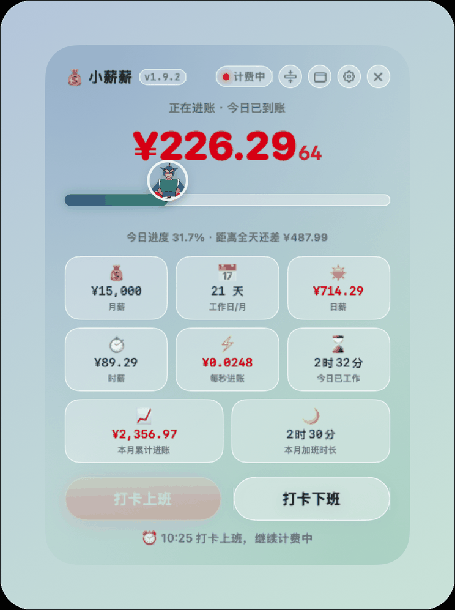
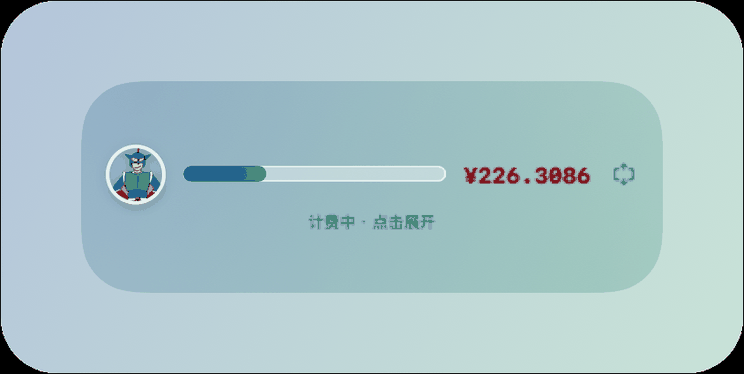

# 小薪薪 · 让每一秒都看得见价值

> 🌐 **在线介绍页**：https://terencetian.github.io/com.haofan.xiaoxinxin/

一枚常驻 macOS 桌面的 **Liquid Glass 悬浮工资计时器**。打卡上班后，实时滚动显示今日已到账金额，金币压在进度条前端一路向前——把月薪拆到每一秒，看着钱一格格进账。



---

## 功能

| 功能 | 说明 |
|---|---|
| 🕐 打卡计时 | 上班打卡后按秒累计工资，下班打卡停止并结算 |
| ⏰ 到点自动下班 | 到计划下班时间自动打卡下班（设置页可关） |
| 🌙 加班计费 | 下班后/过点再打卡识别为加班，首页显示「加班中」，累计加班时长 |
| 🌅 隔天自动重置 | 跨天自动清零今日到账与加班，计费中则从日切时刻重新起算 |
| 📈 月度统计 | 首页显示本月累计进账、本月累计加班时长（按天流水汇总） |
| 📋 流水明细 | 设置页按日期范围查询每日到账与加班，支持手动补记与删除 |
| 💰 金币进度条 | 进度 = 今日已赚 ÷ 日薪，金币沿进度条一路前进 |
| 🎨 图标吸色 | 自动提取进度条图标主色，染遍进度条与窗口背景 |
| ⚙️ 设置页 | 六大功能区可折叠：薪酬 / 工时 / 校正 / 外观 / 窗口 / 流水 |
| 📅 工作日自动计算 | 按 2026 国办法定节假日自动算出当月工作日，含调休补班 |
| ⏱️ 工时自定义 | 自定义上下班时间与休息时长，支持跨零点排班 |
| ▫️ 迷你模式 | 收起成一条小胶囊：图标 + 进度条 + 金额，可一键展回大窗 |
| 💵 状态栏常驻 | 菜单栏图标常驻，可显示实时金额与进度 |
| 📌 贴边收纳 | 小窗拖到屏幕边缘停住，自动收纳进状态栏 |
| 🌗 深色模式 | 跟随系统自动切换浅色/深色 |
| 💾 状态持久化 | 月薪、打卡状态、累计金额本机保存，重启不断计费 |




## 环境要求

- macOS 13 及以上
- macOS 26+ 自动启用原生 Liquid Glass 材质，旧版本回退为常规毛玻璃

**完全离线**：不联网、无统计、无上传，所有数据只存本机。

## 安装

### 方式一：下载安装包（推荐）

直接下载 [xiaoxinxin-v1.9.2.dmg](https://github.com/terencetian/com.haofan.xiaoxinxin/releases/latest)，打开后把「小薪薪」拖进「应用程序」。

> 应用采用 **ad-hoc 签名**（未购买 Apple 开发者账号），首次打开需在
> 「系统设置 → 隐私与安全性」底部点「仍要打开」，或执行：
>
> ```bash
> xattr -dr com.apple.quarantine /Applications/小薪薪.app
> ```

### 方式二：从源码构建

需要 Xcode Command Line Tools（`xcode-select --install`）。

```bash
git clone https://github.com/terencetian/com.haofan.xiaoxinxin.git
cd 工资到账器

# 构建 + 签名 + 安装到 /Applications，一条命令
./deploy.sh
```

脚本做了这些事：在 `/tmp` 里准备 bundle → 编译小组件扩展（入口 `_NSExtensionMain`）
→ 编译主程序 → 组装 appex → 先签扩展再签主 app（**不能 `--deep`**，否则扩展
entitlements 会被覆盖导致不注册）→ `ditto` 安装 → 重新注册扩展并重启 `chronod` / `Dock`。

## 项目结构

```
工资到账器/
├── main.swift              # 主程序：窗口、视图、状态栏、设置页
├── Logic.swift             # 工时与金额计算逻辑
├── test_logic.swift        # 逻辑单测
├── Widget/
│   ├── SalaryWidget.swift  # WidgetKit 扩展
│   ├── Salary.entitlements
│   └── Salary-Info.plist
├── assets/                 # 图标与素材（纯矢量原创绘制）
├── screenshots/            # 界面截图
├── preview.html            # 界面设计预览
├── make_icon.py            # 图标生成脚本
├── deploy.sh               # 构建 + 安装脚本
└── 小薪薪产品手册.md        # 完整产品手册
```

## 版本

当前 **v1.9.2**，更新记录见 [Releases](https://github.com/terencetian/com.haofan.xiaoxinxin/releases)。

## 版权

© 2026 逍狗屁屁. All rights reserved.
