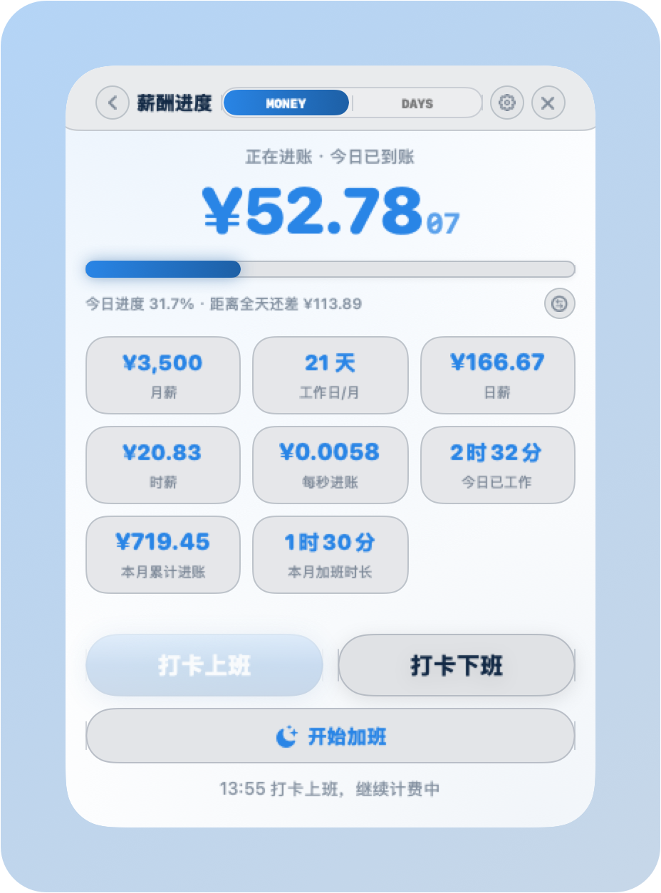
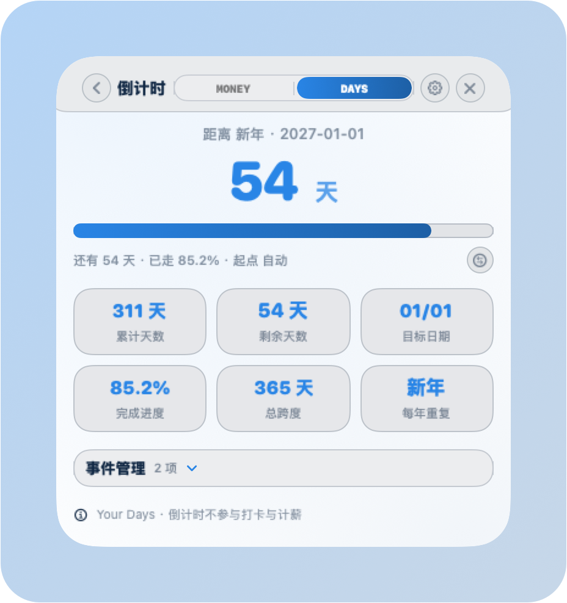
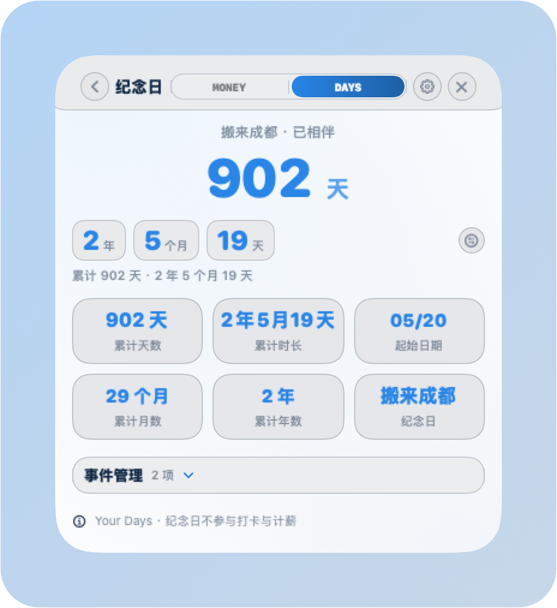
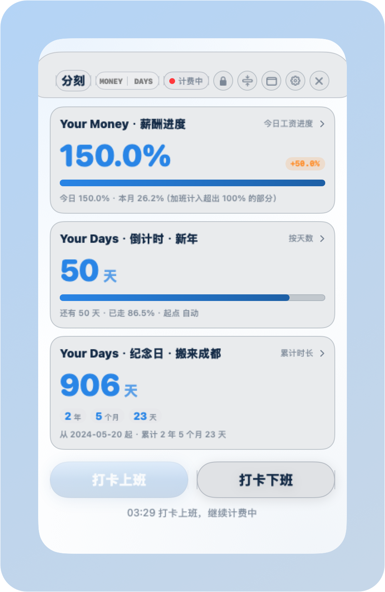

# 分刻 · Countmin · 记录每一段值得的时光

> © 2026 逍狗屁屁 · 源代码依 [MIT License](LICENSE) 开放，应用图标、品牌标识与视觉素材保留所有权利（详见文末「版权与授权」）。
>
> ✏️ **2.7 起由「小薪薪」更名为「分刻 · Countmin」**：去掉了金钱词，内核仍是「时间、刻度、值得记录」。Bundle ID 与数据目录未变，老用户升级后打卡记录、设置、小组件全部原样保留。
>
> 🌐 **在线介绍页**：https://terencetian.github.io/com.haofan.xiaoxinxin/
>
> 📱 **手机版（Android 尝鲜版）**：https://github.com/terencetian/xiaoxinxin-android

一枚常驻 macOS 桌面的 **悬浮工资计时器**（默认「白 + 天蓝」主题，可换 Liquid Glass / 薄荷绿 / Sony 30th）。打卡上班后，实时滚动显示今日已到账金额，金币压在进度条前端一路向前——把月薪拆到每一秒，看着钱一格格进账。

**2.0 起分成两个模块**：**Your Money** 管钱（今日 / 本月工资、工时进度，可开隐私模式把金额变成百分比），**Your Days** 管日子（自定义倒计时、纪念日累计）。首页三张进度卡一眼看全，点进卡片才进二级页。


---

## 功能

| 功能 | 说明 |
|---|---|
| 🕐 打卡计时 | 上班打卡后按秒累计工资，下班打卡停止并结算 |
| 🧭 顶栏工具条（2.6） | 顶栏不再有留白：标题是「关于」按钮、中间是 **MONEY / DAYS 模块切换**、右侧打卡状态胶囊点开可直接上班 / 下班 / 加班；**任何位置都点得住，点一下就把窗口重新提到最前** |
| ✋ 顶部 / 底部拖拽带（2.6.2） | 窗口最上 12pt、最下 12pt 是固定拖拽带：按住即拖、光标变手型，窗口在后台时按一下也会先激活置前，不会再「沉下去」 |
| 🌅 到点自动上班 | 到计划上班时间自动打卡上班；手动打过卡的班次不会被重复打开（设置页可关） |
| ⏰ 到点自动下班 | 到计划下班时间自动打卡下班（设置页可关） |
| 🌙 加班计费 | 下班后/过点再打卡自动识别为加班；2.2 起薪酬页新增「开始加班 / 结束加班」按钮，手动开一段独立计时，该段单独计入加班时长与超出 100% 的进度 |
| 🌅 隔天自动重置 | 跨天自动清零今日到账与加班，计费中则从日切时刻重新起算 |
| 📈 月度统计 | 首页显示本月累计进账、本月累计加班时长（按天流水汇总） |
| 📋 流水明细 | 设置页按日期范围查询每日到账与加班，支持手动补记与删除 |
| 💰 金币进度条 | 默认进度 = 今日已赚 ÷ 日薪，金币沿进度条一路前进；加班超出 100% 的部分另画橙色第二段 |
| 🎨 图标吸色 | 自动裁圆自定义图标；点「吸取图标主色」可把图标主色写入主题重点色 |
| ⚙️ 设置页 | 按 **Your Money / Your Days / 通用与外观** 三大分区组织，共 19 个可折叠分组；**窗口高度与首页一致，内容在页内滚动**（2.4）；分区标题 / 分组卡 / 组内行按色块深度分三级 |
| 🎨 主题与配色（2.2） | 默认 **白 + 天蓝**；另有 **Liquid Glass 透明** / **白 + 薄荷绿** / **Sony 30th**（初代 PlayStation 30 周年浅灰 + 四色按键）。预设只是起点，之后可用系统色卡无极调节**背景色、文本色、重点 / 开关色**，背景**透明度**另有独立滑块；改动即时生效并保存在本机 |
| 🏠 独立首页（2.1） | 首页同时显示三张进度卡：Your Money·薪酬 / Your Days·倒计时 / Your Days·纪念日；点卡片才进入对应二级页，三个模式不共用任何模块 |
| 🗂 事件管理（2.4） | 倒计时页与纪念日页都可直接在页面内**新增 / 改名 / 改日期 / 删除 / 切换当前**，不用再回设置页；两页交互与排版完全一致 |
| ⏱ 倒计时起止（2.4） | 倒计时支持自定义**起始日期**与**目标时刻**（精确到分钟），留空则沿用「创建日 / 上一次同月同日」；进度按秒推进，天数按自然日显示 |
| 📖 纪念日（2.4） | 从起始日按自然日累计，主展示是**累计时长**（X 年 Y 个月 Z 天）而不是进度条；另有累计天数 / 累计月数 / 累计年数等芯片 |
| 📅 工作日自动计算 | 按 2026 国办法定节假日算当月工作日，含调休补班；跨月自动重算 |
| ⏱️ 工时自定义 | 自定义上下班时间与休息时长，支持跨零点排班 |
| ▫️ 迷你模式 | 收起成一条小胶囊：图标 + 进度条 + 金额，可一键展回大窗 |
| 💵 菜单栏显示（2.3） | 菜单栏可直接显示数据，共 6 项可多选：**MONEY** 今日已赚 / 本月累计 / 今日进度 / 本月进度，**DAYS** 倒计时剩余 / 纪念日累计。多项可开「滚动显示」按 3/5/8/12 秒轮播；左侧一枚 MONEY / DAYS 小字分清朝向。**有内容时不显示图标，没有内容时显示 App 图标** |
| 🧩 桌面小组件 | MONEY / DAYS 两个组件，各支持小/中尺寸：工资走今日到账+本月，日子走倒计时剩余天数+纪念日累计；配色与进度条跟随 App 主题（Sony 30th 为四色条），秒级实时走数 |
| 🚀 开机自启 | 走 macOS 13+ 的 SMAppService 登录项，可在「系统设置 → 登录项」管理，失败回退 LaunchAgents |
| 🖥️ Dock 常驻 | 常规应用形态：Dock 有图标、进 Cmd-Tab，点图标捞回悬浮窗 |
| 📌 贴边收纳 | 小窗拖到屏幕边缘停住，自动收纳进状态栏 |
| 🌗 外观跟随主题 | 窗口明暗跟主题走，不再被系统深色模式把浅色主题的文字冲白 |
| 💾 状态持久化 | 月薪、打卡状态、累计金额本机保存，重启不断计费 |
| 🗓 自定义每周工作日 | 自己勾周一到周天哪些算工作日；可选择是否叠加法定节假日 / 调休补班，也支持手填天数 |
| 📊 薪酬进度口径 | 只作用于 Your Money：今日工资 / 本月工资 / 今日工时 / 本月工时，薪酬二级页 ↔ 菜单、状态栏菜单随时切 |
| 🎯 自定义日期倒计时 | 新年、生日、目标日按天走数，年度重复或指定年份；支持「剩余天数」与「完成百分比」两种显示 |
| 🔒 隐私模式 | 4 位数字密码；开启后 Your Money 的金额全部改成百分比进度。8 小时 = 100%，加班 4 小时 = 额外 50% → 150%，月度同理。**隐私不再影响 Your Days**：倒计时 / 纪念日本身不含金额，始终按各自口径显示 |
| 🧩 首页按钮显隐 | 打卡、加班、迷你条、收纳、设置、关闭、切换统计内容都可单独隐藏，状态栏菜单始终保留兜底入口 |
| 🕐 打卡归属（2.2） | 打卡只属于 **Your Money**：薪酬页有上班 / 下班 / 加班三个按钮，首页保留上班 / 下班两个快捷，倒计时与纪念日两个 Your Days 页面完全不显示打卡按钮与薪酬日志 |
| 🧱 三组独立模块开关 | 薪酬页 8 个、倒计时页 6 个、纪念日页 6 个模块各有一套开关，改一边不会影响另一边；首页三张进度卡可单独隐藏，**至少强制保留一张**，不会出现空白首页 |
| 🐛 模式混用修复 | 修复「隐私 + 倒计时」大字显示薪酬进度、芯片却是倒计时的错配；进度数据改为按模式分别计算，并给玻璃底加稳定层，避免彩色桌面壁纸透出导致界面发花 |

> **隐私模式说明**：密码只在本机保存加盐 SHA-256 哈希，不存明文、不联网。关闭隐私、临时查看（60 秒）、修改密码都需要验密码；忘记密码无法找回，退出 App 后执行
> `defaults delete com.haofan.xiaoxinxin pinHash` 并重启即可重置隐私设置（不影响工资数据）。

## 界面

| Your Money · 薪酬页 | Your Days · 倒计时 | Your Days · 纪念日 |
|---|---|---|
|  |  |  |

| 隐私模式（金额变百分比） | 迷你条 | 设置页（19 个分组） |
|---|---|---|
|  |  |  |

## 环境要求

- macOS 13 及以上
- macOS 26+ 自动启用原生 Liquid Glass 材质，旧版本回退为常规毛玻璃

**完全离线**：不联网、无统计、无上传，所有数据只存本机。

## 安装

### 方式一：下载安装包（推荐）

到 [Releases 页面](https://github.com/terencetian/com.haofan.xiaoxinxin/releases/latest) 下载最新版 DMG，打开后把「分刻」拖进「应用程序」。

> 应用采用 **ad-hoc 签名**（未购买 Apple 开发者账号），首次打开需在
> 「系统设置 → 隐私与安全性」底部点「仍要打开」，或执行：
>
> ```bash
> xattr -dr com.apple.quarantine /Applications/分刻.app
> ```

### 方式二：从源码构建

需要 Xcode Command Line Tools（`xcode-select --install`）。

```bash
git clone https://github.com/terencetian/com.haofan.xiaoxinxin.git
cd 工资到账器

# 构建 + 签名 + 安装到 /Applications，一条命令
./deploy.sh
```

脚本做了这些事：在 `/tmp` 里准备 bundle → 编译小组件扩展（入口 `_NSExtensionMain`）
→ 编译主程序 → 组装 appex → 先签扩展再签主 app（**不能 `--deep`**，否则扩展
entitlements 会被覆盖导致不注册）→ `ditto` 安装 → 重新注册扩展并重启 `chronod` / `Dock`。

## 项目结构

```
工资到账器/
├── main.swift              # 主程序：窗口、视图、状态栏、设置页
├── Logic.swift             # 工时与金额计算逻辑
├── test_logic.swift        # 逻辑单测
├── Widget/
│   ├── SalaryWidget.swift  # WidgetKit 扩展
│   ├── Salary.entitlements
│   └── Salary-Info.plist
├── assets/                 # 图标与素材（纯矢量原创绘制）
├── screenshots/            # 界面截图
├── preview.html            # 界面设计预览
├── make_icon.py            # 图标生成脚本
├── deploy.sh               # 构建 + 安装脚本
└── 分刻产品手册.md          # 完整产品手册
```

## 版本

当前 **v2.7.1**（Build 49 · 2026-11-14），属于 **2.0 系列**（2.0.0 起的大改版：三模块首页、四款主题、隐私模式、自定义工作日与倒计时）。更新记录见 [Releases](https://github.com/terencetian/com.haofan.xiaoxinxin/releases)。

### 2.0 系列做了什么

| 版本 | 日期 | 变化 |
|---|---|---|
| **2.7.1 / Build 49** | **11-14** | 修复非工作日仍自动打卡：周末与自定义休息日不再到点就计费 |
| 2.7.0 / Build 48 | 11-12 | 更名「分刻 · Countmin」：去金钱词，回归时间内核；副标题改为「记录每一段值得的时光」 |
| 2.0.0 / Build 31 | 11-07 | 进度条统计内容可切换；自定义工作日、首页按钮显隐、隐私模式落地 |
| 2.1.0 / Build 32 | 11-07 | 首页拆成三张独立进度卡：Your Money / Your Days |
| 2.2.0 / Build 33 | 11-07 | 四款主题 + 无极调色 + 背景透明度；界面去 emoji，用字重与重点色建层级 |
| 2.3.0 / Build 35 | 11-07 | 默认主题改为「白 + 天蓝」；菜单栏 6 项可多选并轮播 |
| 2.4.0 / Build 36 | 11-07 | 「记录日」更名「纪念日」；两个 Your Days 页内置事件管理；设置页与首页等高、页内滚动 |
| 2.5.0 / Build 38 | 11-07 | 小组件按 MONEY / DAYS 拆成两个，配色跟随 App 主题 |
| 2.6.0 / Build 41 | 11-07 | 顶栏重做成整条工具条；图标改成「一半人民币、一半沙漏」 |
| 2.6.2 / Build 43 | 11-08 | 拖窗口改走系统拖窗循环（1:1 跟手）；顶部 / 底部各 12pt 固定拖拽带；点击不再穿透到后面的 App |
| 2.6.6 / Build 47 | 11-10 | 小组件补上午休口径：休息时段进度冻结，不再出现主窗口 83%、小组件 95% 的偏差 |
| 2.6.5 / Build 46 | 11-09 | 午休不再算工时：9:00–18:00 休 60 分钟，16:38 从 95% 回到 83%，18:00 正好 100%；设置页新增「休息从几点开始」 |
| 2.6.4 / Build 45 | 11-09 | 倒计时与纪念日支持修改已添加的事件；事件列表可按 ≡ 拖动排序，或用 ⇅ 菜单上移 / 下移 / 置顶 / 置底 |

### 2.7.1 明细

- **修复非工作日仍自动打卡**：`autoClockInIfNeeded()` 原先只判断当前是否落在「计划上班 ~ 计划下班」的时间窗内，从未检查今天是不是工作日。现在按**班次开始日**调用 `isWorkDate(_:rule:)`，非工作日直接跳过自动打卡；跨零点夜班的凌晨归属前一天的班，不会误判。
- **自动下班不拦**：自动下班只在已经处于「上班中」时触发。周末若手动打卡加班，拦掉自动下班反而会一直计费。
- 开着「叠加法定节假日」时，调休补班的周六仍会自动打卡（符合该开关语义）；想严格只按勾选的工作日，关掉它即可。
- 自检 `--sim-autoin` 补了「非工作日不打卡 / 改回工作日恢复」两条回归，并显式固定工作日，不再依赖当天恰好是工作日。

### 2.7.0 明细

- **改名「分刻 · Countmin」**：原「小薪薪」带金钱词，把 App 框在「工资计时器」上，不利于商店上架与功能延展（倒计时 / 纪念日 / 时间价值）。新名取 `count + min`，双关 *Every minute counts*；中文「分刻」＝ 分钟 + 刻度 / 镌刻，指「为每一分钟建立记录」。
- **只动展示层**：`CFBundleName` / `CFBundleDisplayName` / 可执行文件名 / 关于面板 / 菜单栏 / 通知 / 小组件显示名全部换成新名。界面口径：主界面、状态栏、通知用「分刻」，关于面板与菜单项用「分刻 · Countmin」。
- **有意不动的**：Bundle ID `com.haofan.xiaoxinxin`、URL scheme `xiaoxinxin`、数据目录 `~/Library/Application Support/小薪薪`、小组件 kind（`SalaryWidget` / `DaysWidgetV2`）。改任何一个都要迁移老用户数据、或逼用户重新添加组件——改名不该有这种代价。
- **产物与安装包**：`分刻.app`、`countmin-v<版本>-macos-arm64.dmg`；`deploy.sh` 装完会把旧的 `/Applications/小薪薪.app` 移进废纸篓（不直接删），避免同一个 bundle id 在 Dock 里出现两个图标、登录项指向旧路径。
- 副标题从「让每一秒都看得见价值」换成「记录每一段值得的时光」。

### 2.6.6 明细

- **小组件没跟上午休口径**：2.6.5 只把主程序的工时改成「可计费秒数」，扩展那一路还是 `now - clockInAt` 的墙钟算法 —— 午休那一小时照涨，9:00–18:00 休 60 分钟在 16:38 主窗口 83%、小组件 95%，下班还会顶到 112%。
- 现在主程序把本班次的休息区间（`breakStartTS` / `breakEndTS`，按上班 / 下班 / 休息开始 / 休息时长算好）一并写进快照与偏好域镜像；扩展读不到 `Logic.swift`，就按重叠秒数自己扣。午休期间进度冻结，超出休息区间的时间照常 1:1 计入（晚走加班不受影响）。
- 扩展的停表烘焙（主 App 退出或 3 分钟无心跳时把当前段折进累计值）同样改为剔除午休，避免异常退出时把休息时间算进工时。
- 项目符号更正：2.6.5 明细里写的「小组件与锁屏快照全部改走这个口径」当时并未落地，本条补上。

### 2.6.5 明细

- **午休被算成工时（口径不一致）**：进度分母按有效工时 8 小时（已扣休息），分子却拿墙钟 9 小时算，两边不是一回事 —— 16:38 会显示 95%，到 18:00 直接跑成 112.5%，午休那一小时还在进钱。现在新增 `billableSeconds`：只把落在班次内的真实时间计入工作与计费，休息区间整个跳过。金额、工时、本月累计、进度条、落账流水、小组件与锁屏快照全部改走这个口径。休息期间进度冻结不倒退，18:00 正好 100%，加班按 1:1。
- **新增「休息从几点开始」**（默认 12:00）：休息只有时长没有起点就没法定位置。填的时刻不在班次内时回退「有效工时对半分」；跨零点班次（22:00–06:00 休 02:00–03:00）自动落到次日。
- **改月薪会清零当天累计**：旧版 `onSalaryChanged` 直接 `baseEarned = 0 / workedBeforeSession = 0`，改一次月薪当天赚到的钱和工时全没了。现改为按旧费率把已跑的段结算掉，再从这一刻按新费率起算。
- **改工时把已跑时长抹掉**：旧版 `onScheduleChanged` 只 `clockInAt = now`，既不结算也不累计。现按旧的班次配置结算后再重开，`rebaseCurrentSession` 同样先结算。
| 2.6.3 / Build 44 | 11-09 | 修中尺寸小组件反复变灰骨架：时间线强刷从每 5 分钟降到每小时（烧穿 WidgetKit 日刷新预算所致）；组件时间线条目延长到 75 分钟；跨天重置立刻刷新小组件 |

### 2.6.4 明细

- **事件编辑**：倒计时与纪念日都能改已添加的条目（名称 / 日期 / 目标时刻 / 每年重复 / 自定义起始日 / 显示方式 / 里程碑步长）。修掉三个旧账：编辑时 `createdKey` 被重置成今天，一次性倒计时的进度起点会跟着变；纪念日编辑丢 `mode` 与 `targetDays` 两个字段；全局 `evEditing` 会让两类事件互相串改，现按类拆成 `evEditingKind`。
- **事件排序**：列表顺序即显示顺序，直接落盘。拖动按「插到目标行之前」的语义实现，先移除再按 id 重找落点，悬停同一行重复触发不会推动顺序；另配 ⇅ 菜单的上移 / 下移 / 置顶 / 置底，拖拽手感不灵时一定可用。排序纯函数 `EventOrder` 与 iOS 端同口径。

### 2.6.3 明细

- **中尺寸小组件反复变灰骨架（占位图）的根因**：主 App 每 5 分钟 `reloadAllTimelines` 一次，一天 288 次，远超 WidgetKit 约 40-50 次/天的刷新预算。预算烧穿后时间线过期续不上，实例被系统打回灰色占位图且不再自愈——重启扩展进程只会短暂恢复，烧完又坏。现改为事件驱动（打卡 / 改薪 / 换主题 / 跨天各点各刷）+ 每小时兜底强刷，一天约 25 次。
- 小组件时间线预生成条目从 10 分钟延长到 75 分钟（按秒 10 分钟 + 按 30 秒铺满剩余），条目是预计算的，不消耗刷新预算；过期策略同步放宽到 70 分钟。
- 扩展 `Salary-Info.plist` 版本号从 2.6.0 起一直没跟着升，此次纳入版本同步清单。

### 2.6.2 明细

- **拖窗口终于跟手了**：以前用 SwiftUI `DragGesture` 逐帧 `setFrameOrigin` 搬窗口，实测拖 +120,-80 窗口只走 +56,-45 —— 手势默认 `.local` 坐标系，窗口自己在跟着鼠标动，相对位移被自身移动抵消掉一半；再叠上半透明面板每帧重算阴影，观感就是发飘 + 掉帧。现在按下直接交给系统拖窗循环（`performDrag`），实测 1:1 跟手。
- **顶部 / 底部各加一条 12pt 固定拖拽带**：真实的 `NSView`，压在 SwiftUI 内容之上，永远收得到按下 —— 按住即拖、光标变手型；窗口在后台时按一下也会先激活置前。
- **点击不再穿透到别的 App**：窗口内容层换成容器视图，底下垫一层 1.2% alpha，圆角外沿那些原本完全透明的像素也算「窗口的」；实测四角、顶边、底边点击都能把窗口置前（此前会落到访达 / WorkBuddy 上，观感就是「点一下窗口就沉下去」）。
- 顶栏底色改为不参与命中测试，条内缝隙直接漏给下层拖拽面。

### 2.6.1 明细

- 去掉 SwiftUI `DragGesture` 搬窗口的自研方案，改由 AppKit 背景拖 / `performDrag` 接管。

### 2.6.0 明细

- **顶栏重做**：原来「标题 + Your Money / Your Days 装饰行」两行空白取消，整条顶栏都是可点的控件 —— 标题＝关于、MONEY / DAYS 模块切换、打卡状态菜单，右侧四个圆形按钮不变。
- **点顶栏不再掉层**：任何一次落点在窗口内的点击都会把窗口重新激活并置前。
- **图标改为「对半」**：左半人民币符号、右半沙漏轮廓，同一线宽、同一高度。

## 版权与授权

| 范围 | 授权口径 |
|---|---|
| 源代码与构建脚本（`*.swift` / `*.sh` / `*.py` / `*.plist` 等） | [MIT License](LICENSE)：可自由使用、修改、分发，须保留版权与许可声明 |
| 应用名称「分刻」「Countmin」、App 图标与图标设计、卡通形象「刻刻」及品牌标识 | © 2026 逍狗屁屁. All rights reserved. |
| `assets/` `screenshots/` `poster/` `manual-assets/` 下的图像、海报、截图、版式模板，以及手册成品与 DMG 安装包 | © 2026 逍狗屁屁. All rights reserved. |

MIT 授权**不覆盖**上表后两行的视觉资产与品牌元素；未经书面许可不得将其用于商业用途或再分发，也不得用于暗示与本项目的官方关联。完整条款见 [LICENSE](LICENSE)。

第三方声明：Sony 30th 主题为致敬初代 PlayStation 30 周年的**非官方配色**，PlayStation 及 Sony 相关标识为
Sony Interactive Entertainment Inc. 等权利人的商标，版权归各自所有者；本应用与 Sony Interactive
Entertainment 无任何关联或授权关系。
