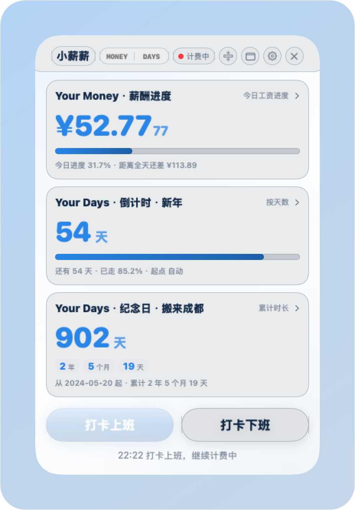
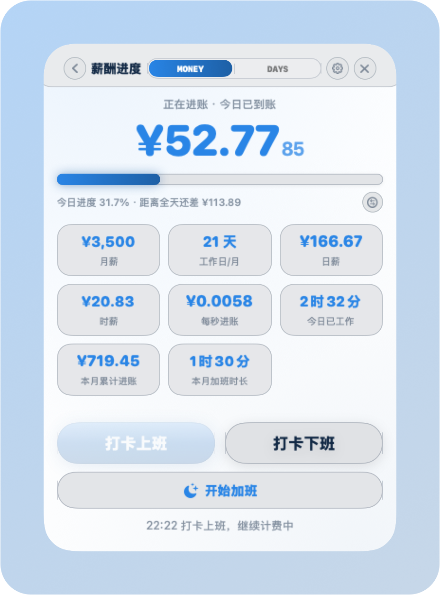
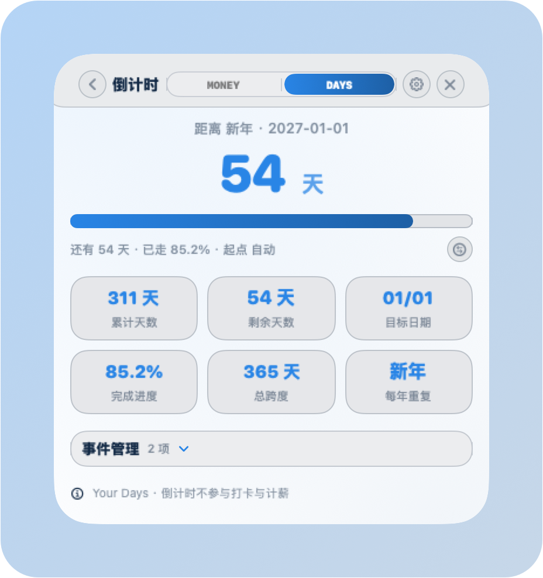
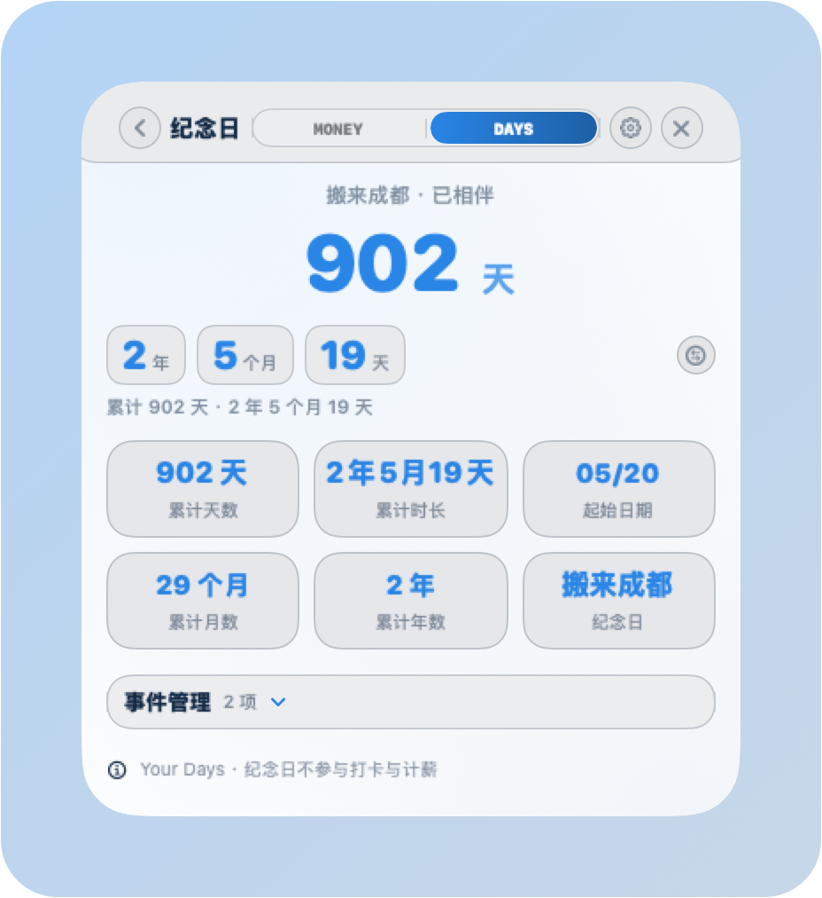
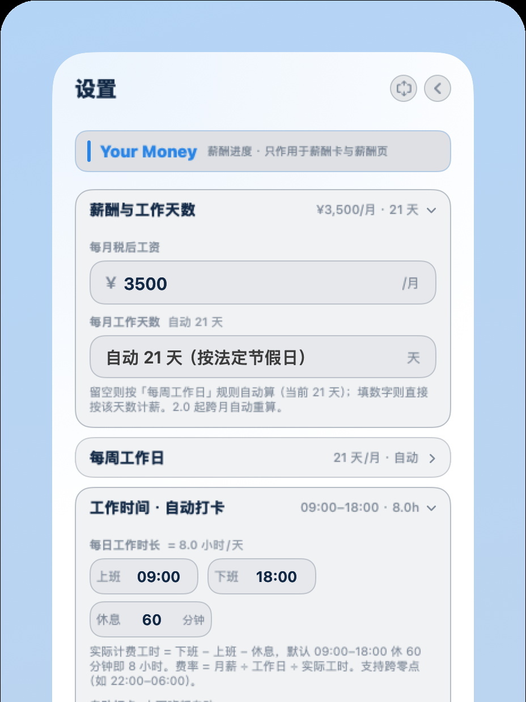
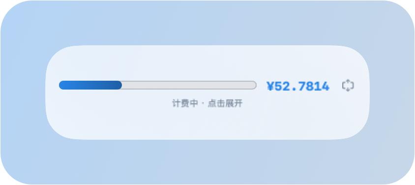
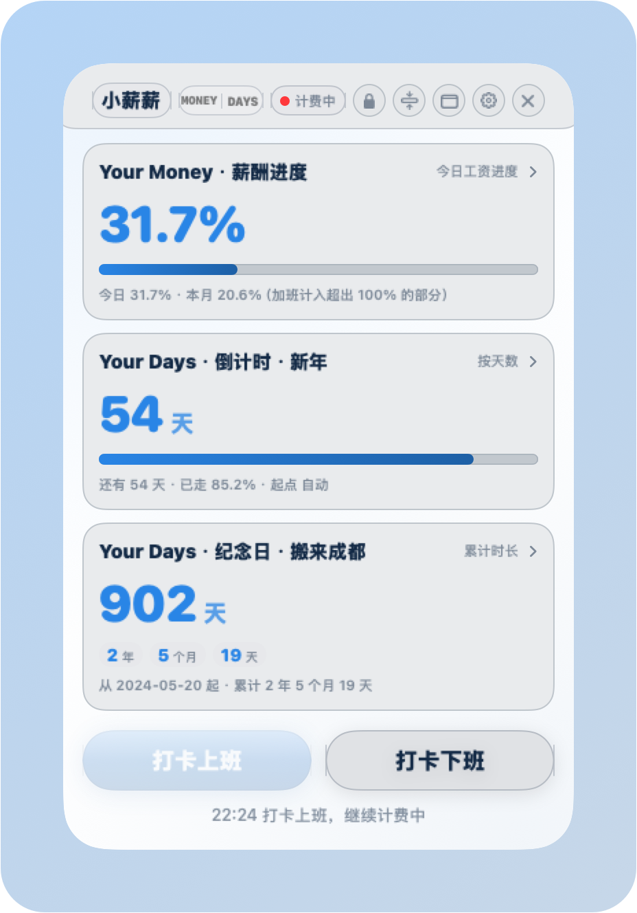

# 小薪薪 · 产品手册

**版本 2.6.2 · macOS 悬浮工资计时器**

> 把月薪拆到每一秒，看着钱一格一格进账。
> 小薪薪是一枚常驻桌面的悬浮小窗：打卡上班后，今日已到账金额实时滚动，进度条上的金币一路向前。2.0 起它分成 **Your Money（钱）** 与 **Your Days（日子）** 两个模块——一边算今天赚了多少，一边数离目标还有几天。

---

## 一、产品简介

小薪薪面向所有「想知道自己的时间值多少钱」的打工人。输入月薪后，它按 **月薪 ÷ 当月工作日 ÷ 实际工时** 折算出每秒进账，从打卡那一刻开始实时累计——每攒满 1 分钱，屏幕上就飘出一枚 `+¥0.01`。

| 项目 | 说明 |
|---|---|
| 平台 | macOS 13 及以上（macOS 26+ 用原生 Liquid Glass 材质） |
| 形态 | 无边框悬浮小窗 + 菜单栏常驻 + 桌面小组件 |
| 默认主题 | **白 + 天蓝**；另有 Liquid Glass 透明 / 白 + 薄荷绿 / Sony 30th |
| 图标 | 对半图标：左半人民币符号、右半沙漏轮廓，纯矢量原创绘制 |
| 网络 | **完全离线**，不联网、无统计、无上传 |
| 数据 | 全部存本机（`UserDefaults`），删除 App 即清空 |
| 分寸 | 窗口 372pt 宽、贴边即收纳，不挡桌面也不抢焦点 |

## 二、2.0 带来了什么

2.0 把「一个工资计时器」拆成了两个互不打扰的模块，并补上了一整套外观与隐私能力。

| 能力 | 说明 |
|---|---|
| 🏠 **三张卡的首页** | 首页同时显示 Your Money·薪酬 / Your Days·倒计时 / Your Days·纪念日三张进度卡，点卡片才进二级页；三张卡可单独隐藏，**至少保留一张** |
| 🧭 **顶栏工具条** | 顶栏没有留白了：标题＝关于、中间 MONEY / DAYS 模块切换、右侧打卡状态胶囊；**点哪儿都能把窗口提到最前** |
| ✋ **顶部 / 底部拖拽带** | 窗口最上、最下各 12pt 是固定拖拽带，按住即拖、光标变手型，后台状态下按一下先激活再拖，不会再「点一下就沉下去」 |
| 🎨 **四款主题 + 无极调色** | 预设只是起点，背景色 / 文本色 / 重点色可用系统色卡随意调，背景透明度另有独立滑块 |
| 🔒 **隐私模式** | 4 位密码；开启后所有金额变成百分比进度（8 小时 = 100%，加班 4 小时 → 150%），临时查看 60 秒 |
| 🗓 **自定义工作日** | 周一到周天哪些算工作日自己勾，可叠加法定节假日 / 调休，也可直接手填天数 |
| 🎯 **自定义倒计时** | 新年、生日、项目上线按天走数；每年重复或指定年份，显示天数或完成百分比 |
| 📖 **纪念日** | 从起始日按自然日累计，「2 年 5 个月 19 天」一眼看到底 |
| 🗂 **页内事件管理** | 倒计时页 / 纪念日页都能直接新增、改名、改日期、删除、切换当前，不用回设置页 |
| 💵 **菜单栏 6 项可多选** | 今日已赚 / 本月累计 / 今日进度 / 本月进度 / 倒计时剩余 / 纪念日累计，可轮播 |
| 🧩 **双组件** | MONEY 与 DAYS 两个桌面小组件，配色跟随 App 主题，秒级走数 |

## 三、快速上手

1. **填月薪**：右上角齿轮进设置页 →「薪酬与工作天数」→ 填每月税后工资（工作日与工时保持默认即可）。
2. **打卡上班**：首页点「打卡上班」，金额开始滚动；也可以点顶栏的「计费中」胶囊，那里能直接上班 / 下班 / 开始加班。
3. **下班结算**：点「打卡下班」结束本段；开着「自动打卡」的话到点它会自己停。
4. **加一个日子**：点「Your Days · 倒计时」卡片 → 「事件管理」→ 新增，填名称与日期（新年、生日这类可勾「每年重复」）。
5. **换个皮肤**：设置 →「主题与配色」，四款预设任选，之后还能继续用色卡微调。

> 没填月薪时首页会出现「去设置填写月薪」引导，点一下直达设置页。

## 四、界面详解

### 4.1 首页 · 三张进度卡



| 区域 | 说明 |
|---|---|
| 顶栏 | 标题按钮（＝关于）、MONEY / DAYS 模块切换、打卡状态胶囊，右侧四个圆形按钮：迷你 / 收纳 / 设置 / 关闭 |
| Your Money · 薪酬进度 | 大号金额实时滚动 + 金币进度条；右下角小字「今日进度 31.7% · 距离全天还差 ¥113.89」 |
| Your Days · 倒计时 | 「54 天」+ 进度条 + 「已走 85.2%」；右上角切换「按天数 / 按百分比」 |
| Your Days · 纪念日 | 「902 天」+ 年 / 月 / 天芯片 + 起始日期 |
| 打卡区 | 上班 / 下班两个按钮（薪酬页另有「开始加班」），计费中上班键置灰，永远不会两个都能点 |
| 日志行 | 最近一次打卡 / 校正 / 费率变更记录 |

> 三张卡片的显隐在设置 →「首页布局」里控制；**至少强制保留一张**，不会出现空白首页。

### 4.2 顶栏工具条

顶栏是一整条控件，没有死区：

| 控件 | 点下去 |
|---|---|
| 「小薪薪」标题 | 打开关于面板（版本、Build、发版日期、迭代记录、Sony 版权声明） |
| MONEY / DAYS | 切换首页与二级页所属模块，二级页的打卡按钮、进度口径跟着模块走 |
| 「计费中 / 加班中 / 未打卡」胶囊 | 弹菜单：打卡上班 / 打卡下班 / 开始加班 / 结束加班 |
| 🔒 锁 | 只有开了隐私模式才出现，点一下临时解锁 60 秒 |
| ⇩ 迷你 | 收成一条小胶囊 |
| ▢ 收纳 | 收进菜单栏 |
| ⚙︎ 设置 | 进设置页 |
| ✕ 关闭 | 收纳到菜单栏（可在设置里改成直接退出） |

**拖窗口**：窗口最上 / 最下各有一条 12pt 的拖拽带，按住即拖、光标变手型；页面里的空白处同样可以拖。窗口在后台时按一下只会把它激活置前，不会把点击交给后面的 App。

### 4.3 Your Money · 薪酬页



| 元件 | 说明 |
|---|---|
| 今日已到账 | 大号金额按秒滚动，精确到分 |
| 金币进度条 | 进度 = 今日已赚 ÷ 日薪；加班超出 100% 的部分另画一段橙色 |
| 八块芯片 | 月薪 / 工作日 / 日薪 / 时薪 / 每秒进账 / 今日已工作 / 本月累计进账 / 本月加班时长（可单独隐藏） |
| 三个按钮 | 上班、下班、开始加班——加班段独立计时，单独计入加班时长 |
| 进度口径 | 今日工资 / 本月工资 / 今日工时 / 本月工时，随时切，二级页与菜单栏同步 |

### 4.4 Your Days · 倒计时页



- **主展示**是剩余天数（或完成百分比），下面一条进度条与「已走 85.2% · 起点自动」；
- **芯片**：累计天数、剩余天数、目标日期、完成进度、总跨度、重复方式；
- **事件管理**（页内展开）：新增 / 改名 / 改日期 / 删除 / 切换当前。每年重复的（新年、生日）只填月日；一次性的（项目上线）填年份，并可指定**起始日**与**目标时刻**（精确到分钟）来算进度；
- 两种显示模式：**按天数**（还剩多少天）与**按百分比**（走完了多少），点右上角切换。

### 4.5 Your Days · 纪念日页



- 主展示是**累计时长**而不是进度条：「2 年 5 个月 19 天」，下面一行「累计 902 天」；
- **芯片**：累计天数、累计时长、起始日期、累计月数、累计年数、名称；
- 同样内置**事件管理**，交互与倒计时页完全一致（「在一起」「入职」「搬来成都」这类都能记）；
- 里程碑口径：默认每 100 天一个节点，也可以自定义目标天数。

### 4.6 设置页 · 三大分区 19 个分组



设置页窗口高度与首页一致，分组多了就在页内滚动，不会把窗口拉成一条长条。

| 分区 | 分组 |
|---|---|
| **Your Money** | 薪酬与工作天数 · 每周工作日 · 工作时间与自动打卡 · 薪酬进度口径 · 薪酬页模块 · 工时校正 · 流水明细 |
| **Your Days** | 日期倒计时 · 倒计时页模块 · 纪念日 · 纪念日页模块 |
| **通用与外观** | 主题与配色 · 首页布局 · 首页按钮 · 隐私模式 · 菜单栏显示 · 外观与图标 · 窗口与启动 · 版本与版权 |


分组卡片按「分区标题 → 分组卡 → 组内行」三级色块分层，一眼看得出层级；点标题展开 / 收起，右上角能一键全展开或全折叠。

### 4.7 迷你条



首页点 ⇩ 收起成一条 330×120 的小胶囊：**进度条 + 实时金额**，下面一行「计费中 · 点击展开」。点任意处展开回大窗，计费不中断。

### 4.8 菜单栏

菜单栏可以**直接显示数据**，在设置 →「菜单栏显示」里勾：

| 组别 | 可选项 |
|---|---|
| MONEY | 今日已赚 / 本月累计 / 今日进度 / 本月进度 |
| DAYS | 倒计时剩余 / 纪念日累计 |

- 多项同时开启可打开「滚动显示」，按 3 / 5 / 8 / 12 秒轮播；
- 左侧一枚 MONEY / DAYS 小字，说明这一屏是哪边；
- **有内容时不显示图标**，没内容时显示 App 图标；
- 单击菜单栏图标 = 显隐小窗，双指点按 = 完整菜单（打卡、迷你、收纳、设置、关于、退出）。

### 4.9 桌面小组件

长按桌面 → 编辑小组件 → 搜「小薪薪」，或从通知中心添加。**MONEY** 与 **DAYS** 是两个独立组件，各支持小 / 中两种尺寸：

| 组件 | 小 | 中 |
|---|---|---|
| MONEY | 今日已到账 + 进度条 | 今日已到账 + 金币进度条 + 今日进度 |
| DAYS | 倒计时剩余天数 | 倒计时剩余天数 + 纪念日累计 |

- **秒级实时**：预生成一分钟内每一秒的时间线，金额是一位一位跳的；
- **配色跟随主题**：进度条用当前主题的重点色（Sony 30th 是四色条）；
- **关掉主窗口也在走**：数据由主 App 后台写入，窗口关了照样计费；
- **完全退出会停表**：停在退出那一刻，避免显示一个没人算的假数字。

> 组件不刷新时：先点一下小薪薪唤醒 App；仍不动就在终端执行 `killall chronod` 让系统重新加载扩展。

## 五、主题与配色

默认是 **白 + 天蓝**（浅色底、天蓝重点色，白天夜里都不刺眼）。另有三种：

| 预设 | 观感 |
|---|---|
| 白 + 天蓝（默认） | 纯白底 + 天蓝重点色，冷静通透 |
| Liquid Glass | 初始透明玻璃，跟随桌面光影，背景透明度可单独调 |
| 白 + 薄荷绿 | 纯白底 + 薄荷绿重点色，清爽不刺眼 |
| Sony 30th | 距今 30 年初代 PlayStation 的浅灰机身 + 四色按键点缀（非官方致敬） |

预设只是起点：设置 →「主题与配色」里能用系统色卡**无极调节**背景色、文本色、重点色，背景**透明度**另有独立滑块，改动即时生效并存本机。上传自定义图标后可点「吸取图标主色」，把图标主色直接写进重点色。

> Sony 30th 为致敬初代 PlayStation 30 周年的非官方配色，PlayStation 及 Sony 相关标识归 Sony Interactive Entertainment Inc. 等权利人所有，本应用与 Sony 无任何关联或授权关系。

## 六、隐私模式



适合上班摸鱼、有人从背后路过、或者投屏的时候。

| 能力 | 说明 |
|---|---|
| 密码 | 4 位数字，只在本机保存**加盐 SHA-256 哈希**，不存明文、不联网 |
| 隐藏什么 | Your Money 的金额、月薪、日薪、时薪、每秒进账、本月累计全部变成百分比 |
| 百分比口径 | 8 小时 = 100%，加班 4 小时 = 额外 50% → **150%**；月度同理 |
| 不影响什么 | Your Days（倒计时 / 纪念日）本来就不含金额，始终按各自口径显示 |
| 临时查看 | 点顶栏 🔒 输入密码，解锁 60 秒后自动再锁 |
| 忘记密码 | 无法找回。退出 App 后执行 `defaults delete com.haofan.xiaoxinxin pinHash` 再启动即可重置（不影响工资数据） |

## 七、计费与进度口径

```
每秒进账 = 月薪 ÷ 当月工作日 ÷ 实际计费工时 ÷ 3600
实际计费工时 = 下班时间 − 上班时间 − 休息时长
今日进度 = 今日已到账 ÷ 日薪（日薪 = 月薪 ÷ 当月工作日）
加班进度 = 加班时长 ÷ 标准工时（另画一段橙色，总进度可超过 100%）
```

示例：月薪 **¥3,500**、当月 **21** 个工作日、每天 8 小时 → 日薪 **¥166.67**、时薪 **¥20.83**、每秒约 **¥0.0058**。

**几个容易踩的点**

- 计时基于真实时间戳，页面切到后台、窗口收进菜单栏都照算；
- 中途退出 App，重开会按原打卡时间继续计费；
- 改月薪或工时后，当前这一段从修改时刻起按新费率重算，不重复计；
- **自动上班**：进入 [计划上班, 计划下班) 且本班次还没打过卡，就从计划上班时刻起算；错过整点（比如 10 点才开机）从开机时刻起算，不白送工时；
- **自动下班**：本段开始于计划下班之前且已过下班时刻，自动停表；
- **加班**：过了下班时刻再打卡，或手动「开始加班」，都按原费率继续进账，并计入当日加班时长。

**工作日怎么算**

| 方式 | 适用 |
|---|---|
| 自动（默认） | 按 2026 国办法定节假日推算当月工作日，含调休补班，跨月自动重算 |
| 自定义每周 | 周一到周天自己勾，可选是否叠加法定节假日 / 调休；大小周、单休公司用这个 |
| 手填天数 | 直接写死当月工作日，清空即恢复自动 |

## 八、数据与隐私

- 所有数据（月薪、工时配置、打卡状态、累计金额、历史流水、倒计时与纪念日、自定义图标、主题配色、菜单栏项）只存本机，**不联网、不上传**；
- 隐私密码只存加盐哈希，App 无法反推出原始密码；
- 升级不会丢数据：跨版本会自动迁移旧存档；
- 流水明细保留最近两个月，更早的自动清理；
- 清除数据 = 删除 App（数据随沙箱一起清除）。

## 九、安装与分发

1. 双击 `小薪薪-v2.6.2-macos-arm64.dmg` 挂载；
2. 把 **小薪薪.app** 拖进「应用程序」；
3. 首次打开若被 Gatekeeper 拦住：**右键 → 打开**，或到「系统设置 → 隐私与安全性」底部点「仍要打开」，也可以执行：

```bash
xattr -dr com.apple.quarantine /Applications/小薪薪.app
```

> 应用是 ad-hoc 签名（没有购买 Apple 开发者账号），所以首次需要手动放行，与功能无关。分发给他人直接把 dmg 发过去即可，各自的工资数据存在各自电脑上。

## 十、常见问题

**Q：点窗口会不会让它沉到别的窗口后面？**
A：不会了。窗口最上层有固定的拖拽带，点一下先把窗口激活置前；内容层底下还垫了一层 1.2% 的底，圆角外沿那几个像素也算窗口的，点击不会再穿透给后面的 App。

**Q：拖窗口发飘 / 跟不上鼠标？**
A：2.6.2 已修。以前是每帧搬窗口，位移会被窗口自身的移动抵消一半；现在交给系统拖窗循环，鼠标走多远窗口就走多远。

**Q：打卡按钮点了没反应？**
A：先看是否填了月薪（没填时按钮置灰，首页会有引导条）。另外打卡只属于 Your Money，倒计时 / 纪念日两个页面不显示打卡按钮，这是设计如此。

**Q：隐私模式开了，为什么倒计时还能看到天数？**
A：隐私只作用于 Your Money 的金额。Your Days 里没有金额，天数和日期照常显示；需要连日子一起藏，可以把对应的首页卡片在「首页布局」里关掉。

**Q：加班怎么折算百分比？**
A：标准 8 小时 = 100%，加班 4 小时 = 额外 50%，当天总进度 150%；月度累计同理，超出的部分在进度条上单独画一段橙色。

**Q：忘记点上班打卡怎么办？**
A：设置 →「工时校正」，填今天实际工作的小时数（支持 3.5 这种小数）点校正，App 会与已计工时求差额，多了核减、少了补记。隔天的历史日子用「流水明细 → 手动添加」。

**Q：昨天那天的账不对能改吗？**
A：能。设置 →「流水明细」按日期查到那条，删掉后重新手动添加正确数值；今天的数用「工时校正」调。

**Q：上夜班、跨零点怎么算？**
A：工作时间支持跨零点，比如 22:00–06:00、休息 60 分钟，实际工时自动算 7 小时。

**Q：大小周 / 单休怎么设？**
A：设置 →「每周工作日」，勾出本周上班的日子；如果公司还调休，把「叠加法定节假日与调休」打开。

**Q：菜单栏图标点了没反应？**
A：单击是显隐小窗，完整菜单要双指点按（右键）。仍无反应就退出 App 重开。

**Q：小组件金额不动 / 搜不到？**
A：先确认主 App 还在跑（Dock 图标在）。完全退出时组件会停在退出那一刻，这是设计如此。App 在跑但不动、或组件库里搜不到，执行 `killall chronod` 再试；还是不行就重启一次系统让扩展完成注册。

**Q：窗口跑到屏幕外了？**
A：点 Dock 图标或菜单栏图标会把窗口捞回前台；窗口贴边停住会自动收纳进菜单栏。

## 十一、版本记录

| 版本 | 日期 | 要点 |
|---|---|---|
| **2.6.2** | 2026-11-08 | 拖窗口改走系统拖窗循环（1:1 跟手）；顶部 / 底部各加 12pt 固定拖拽带；点击不再穿透到后面的 App |
| 2.6.0 | 2026-11-07 | 顶栏重做成整条工具条；图标改成「一半人民币、一半沙漏」 |
| 2.5.0 | 2026-11-07 | 小组件按 MONEY / DAYS 拆成两个，配色跟随主题 |
| 2.4.0 | 2026-11-07 | 「记录日」更名「纪念日」；两个 Your Days 页内置事件管理；设置页与首页等高 |
| 2.3.0 | 2026-11-07 | 默认主题改为「白 + 天蓝」；菜单栏 6 项可多选并轮播 |
| 2.2.0 | 2026-11-07 | 四款主题 + 无极调色 + 背景透明度；界面去 emoji |
| 2.1.0 | 2026-11-07 | 首页拆成三张独立进度卡（Your Money / Your Days） |
| 2.0.0 | 2026-11-07 | 进度条统计内容可切换；自定义工作日、首页按钮显隐、隐私模式落地 |

---

*小薪薪 · 让每一秒都看得见价值。*
